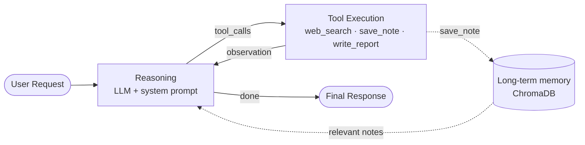

# Agentic AI Assistant: the runnable agent from the video

This is the code the developer types on screen, made fully working. Give it a goal such as
*"Research three competitors and create a summary report."* and it will:

1. **reason** about the task and make a plan (LLM: `gpt-4o`)
2. **decide** on its own whether it needs a tool
3. **act**: search the web, save notes to memory, write a report
4. **observe** the tool results and loop back to reasoning
5. **stop** when the task is done (or after `MAX_STEPS`) and return the answer



## Files

| File | What it does |
|---|---|
| `agent.py` | **The brain.** Builds the LangGraph `StateGraph`: a `reasoning` node (LLM with tools bound), a `tools` node, and `should_continue()`, the decision logic that routes to tools or to `END`. Short-term memory per conversation thread comes from `MemorySaver`. |
| `prompts.py` | The system prompt: goal, working method and rules. Also `MAX_STEPS`, a safety limit on loops. |
| `tools.py` | Three tools the agent may choose from: `web_search` (Tavily), `save_note` (long-term memory) and `write_report` (markdown report). The `@tool` decorator turns the docstring and type hints into the schema the LLM sees. |
| `memory.py` | `LongTermMemory`: a ChromaDB vector store. `add()` saves text and `search()` returns the most similar notes. It persists in `chroma_data/`. |
| `main.py` | Runs the agent in the terminal (with coloured live logs like the video) or as a web app (`--serve`). |
| `test_offline.py` | Runs the real graph with a scripted fake LLM, with no keys or internet needed. Use it to check your install. |

> **One difference from the video:** the video shows `TavilySearchResults` from `langchain_community`. That class is now
> deprecated, so this code uses its replacement, `TavilySearch` from the `langchain-tavily` package. It behaves the same way.

## Setup

You need **Python 3.10+**, an **OpenAI API key** (https://platform.openai.com/api-keys) and a free **Tavily API key**
(https://tavily.com) for web search.

```bash
cd agent-example
python -m venv .venv
source .venv/bin/activate            # Windows: .venv\Scripts\activate
pip install -r requirements.txt

python test_offline.py               # should end with ✅ Offline test passed

cp .env.example .env                 # Windows: copy .env.example .env
# open .env and paste your OPENAI_API_KEY and TAVILY_API_KEY
```

## Run it

```bash
# one task
python main.py "Research three competitors in the online MBA market and create a summary report."

# interactive chat (the agent remembers earlier messages in the same session)
python main.py

# web playground → open http://127.0.0.1:8000
python main.py --serve
```

The terminal shows each step live:

```
───────────────────────────── task 7f3a91 ─────────────────────────────
10:42:07 TASK    "Research three competitors and create a summary report."
10:42:08 NODE    reasoning    ▸ step 1
10:42:08 DECIDE  → tools
10:42:08 TOOL    web_search(query='leading online MBA providers India 2026')
10:42:09 RESULT  web_search: {'query': …, 'results': [{'title': …
10:42:11 NODE    reasoning    ▸ step 2
…
10:42:19 DECIDE  → END
10:42:19 DONE    9 steps · 6 tool calls · 18.4s
```

The REST API is also available: `POST /api/tasks` with `{"task": "...", "thread_id": "optional"}`.

## How the agent loop works (in `agent.py`)

```python
graph = StateGraph(AgentState)
graph.add_node("reasoning", reasoning)          # LLM thinks and maybe requests tools
graph.add_node("tools", ToolNode(TOOLS))        # runs whatever tools the LLM asked for
graph.add_edge(START, "reasoning")
graph.add_conditional_edges("reasoning", should_continue)   # → "tools" or END
graph.add_edge("tools", "reasoning")            # observe results, think again
agent = graph.compile(checkpointer=checkpointer)
```

`should_continue` is the whole "autonomy": if the LLM's last message contains `tool_calls` (and we're under
`MAX_STEPS`), go to `tools`; otherwise finish. The LLM decides **which** tool to use and **when**. You only
describe the tools.

## Make it yours

- **Add a tool.** Write a function in `tools.py` with `@tool`, a docstring and type hints, then add it to `TOOLS`. That's all.
  ```python
  @tool
  def calculator(expression: str) -> str:
      """Evaluate a basic arithmetic expression like '12*(3+4)'."""
      import ast, operator as op
      ops = {ast.Add: op.add, ast.Sub: op.sub, ast.Mult: op.mul, ast.Div: op.truediv, ast.USub: op.neg}
      def ev(n):
          if isinstance(n, ast.Constant): return n.value
          if isinstance(n, ast.BinOp): return ops[type(n.op)](ev(n.left), ev(n.right))
          if isinstance(n, ast.UnaryOp): return ops[type(n.op)](ev(n.operand))
          raise ValueError("unsupported expression")
      return str(ev(ast.parse(expression, mode="eval").body))
  ```
- **Change its personality or rules:** edit `SYSTEM_PROMPT` in `prompts.py`.
- **Use another model:** change `ChatOpenAI(model="gpt-4o")` in `agent.py`, e.g. `gpt-4o-mini` (cheaper).
- **Offline memory:** set `MEMORY_EMBEDDINGS=local` in `.env` (downloads a small embedding model once).

## Costs and safety

- Every run calls the OpenAI API and is billed to your key. `gpt-4o-mini` is much cheaper for practice.
- Never commit `.env`. It's already in `.gitignore`.
- The agent only has the three tools above. It cannot run code or touch your files unless you add a tool that does.
